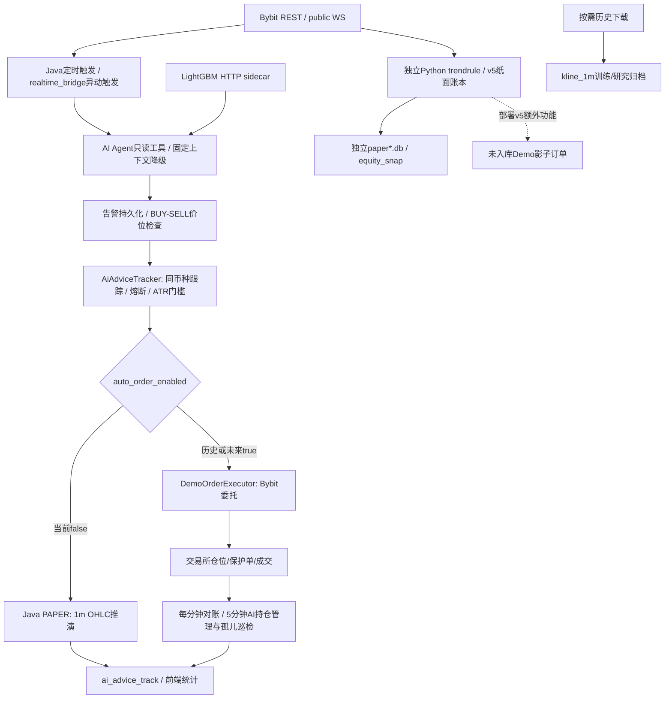

# QF-S 独立审计、亏损归因与实证修复

审计日：2026-11-12（香港时间）。结论针对 `QuanForge-springboot`，不使用同机旧版 Python/FastAPI QuantForge 的交易、数据库或审计结论。

**结论：已确认严重工程缺陷，也观察到策略前向毛收益不佳与显著交易成本。两者同时存在。现有证据不支持“修好工程就能盈利”，也不支持把亏损全部归给策略。当前不满足无人值守自动 Demo 的工程准入条件。** 本次交付是本地代码、失败/通过测试、历史行情退出实验和逐笔证据；生产没有部署或重新启用。

## 1. 证据与运行版本

- 本地基线：`23b1a9b5001da28d2a84d87be02a160da83839ae`。初始 tracked diff 为空；用户已有未跟踪文本文件保留未动。
- SSH 只读确认：`xingfeng@192.168.8.240`；QF-S Java `/mnt/nvme/quanforge/quanforge.jar` 正在运行，桥与模型 sidecar 正在运行。旧版 `quantforge-*` 不纳入本审计。
- 当前 Java `mode=DEMO`、AI 开启、`auto_order_enabled=0`。三个 trend-rule 纸面服务均 inactive/disabled；v5 inactive/enabled，存在每 15 分钟运行的停机 guard。不能把所有模块都说成当前自动交易链路。
- v5 **部署代码与 Git 不同**：多约 230 行未入库的 Demo 影子下单/对账。部署源码 SHA-256 `a2e33d37b5b2e2558f500b9df20288f8cf4a47a6aafe774fd9686409a978d665`。trendrule、backtest、bridge 的部署 Python 与基线一致。未把不一致的 v5 冒称同一版本。
- 部署 jar SHA-256 `980b07de865cbb6714f64dc9cb90847c2cc8670b6dcd146ee9f4258a4dbf697d`；没有可验证的完整部署 Git commit。已用部署 class 的 `javap` 独立核对关键 Java 缺陷，不以工作区源码直接推断全部部署行为。
- 用 SQLite online backup 保存运行数据库的一致性快照，另保存部署源码/class、日志、服务状态、哈希。原数据库、凭证、服务、仓位均未修改。原始证据在本地 `.audit-private/qfs-audit-20261112-0805/`，含敏感数据，被 Git 排除。
- 交易所取证只经过 Java 已配置 Demo 凭证的 **GET** 接口：按不超过 7 天的时间窗分页。初始页预算耗尽的窗口进行了有限续页，取回去重后 522 条 closed-pnl、1,139 条 execution、1,052 条订单记录。观察时 USDT linear 仓位/活动委托均为 0；这不证明其他凭证账户没有仓位。
- 后补公开 Bybit 历史行情，原始响应/下载范围保留。逐笔输出包含 **2,349 条已入场记录**，其中 **2,328 条具有持仓内完整分钟的行情覆盖**；21 条没有足够完整持仓分钟，通常涉及极短交易/边界。完整分钟覆盖不等于有逐 tick 路径。

清单：[runtime-inventory.json](runtime-inventory.json)、[trade-evidence-summary.json](trade-evidence-summary.json)、[data-integrity.json](data-integrity.json)。

## 2. 真实交易链路



Java 工具、固定上下文、风险检查、执行前 ticker 各自拉取，历史库不是统一实时行情总线。Python 纸面臂、Java PAPER、Java DEMO、部署 v5 shadow、历史回测是不同执行口径。当前 Java 自动单关闭；图中的 Demo 路径历史上执行过，不代表审计时在自动开仓。

重启并非“全部丢失”：Java 的跟踪、价位、数量、orderId、rebasedAt 已落库；冷却和部分扫描状态在内存。原 v5 恢复 OPEN 行但不恢复趋势/处理游标及原始敞口。trendrule 的 pending/冷却也不完整恢复。外部订单接受与 SQLite 提交之间没有完整事务协议。

## 3. 为什么亏损：观察到的账务和策略结果

### 3.1 Demo 账户的实际成本分解

对取回的 522 条平仓记录，用其成交均价、closedSize 与方向重新计算价差毛损益，并核对 openFee/closeFee；用 execution 的 Funding 项独立求和：

| 项目 | USDT | 证据解释 |
| --- | ---: | --- |
| 价差毛损益 | -18.308483 | 已成交价包含滑点，不能再从该数中单独分离滑点 |
| 平仓记录开/平手续费 | -154.841239 | 直接读取交易所费用字段，不是费率猜测 |
| 资金费现金成本 | -1.634199 | 87 条 Funding execution 的 execFee 合计 |
| 上述重建结果 | -174.783921 | 与交易所合计只差约 0.000041 USDT |
| closedPnl 合计 | **-174.783880** | 已含相应成本，不再重复扣费 |

这是**账户已平仓现金损益分解**，不是资金收益率：没有用钱包期初/期末、申请模拟资金/出入金建立净值桥。也不是“每个策略亏损的分摊表”：同账户含不同执行来源，只有 409 条 Java 入场能用 entry orderId 精确关联手续费；55 条满足时间/方向/数量/均价约束的唯一平仓候选仍只是候选，未冒充严格逐单身份。

结论可以说“成本是此账户已观察损失的重要组成部分，价差本身也为负”。不能说“删掉手续费策略就稳定有效”，不能把 522 条全归给某一个策略，更不能把全部费用归因于重复交易 bug。trade execution 费用与 closed-pnl 分配的费用还差约 0.0354 USDT，来源窗口/费用分配需要资金账单进一步核验。

### 3.2 所有可用前向纸面臂，包含失败臂

| 账本 | 已入场记录 | WIN / LOSS标签 | 记录末权益（起点200） | 账面毛收益 | 已实现权益曲线最大回撤 |
| --- | ---: | ---: | ---: | ---: | ---: |
| trendrule 3R | 667 | 141 / 526 | 66.90 | -66.55% | 75.22% |
| trendrule 5R | 604 | 99 / 505 | 88.90 | -55.55% | 69.16% |
| trendrule 5R-cap | 304 | 43 / 261 | 89.95 | -55.03% | 63.87% |
| v5-mech | 42 | 15 / 27 | 224.96 | +12.48% | 11.02% |

3R/5R 区间主要为 8 月 20 日至 9 月 19 日；cap 从 8 月 31 日起；v5 为 9 月至 10 月 26 日。它们不是相同时间样本，不能据此排名或拼接组合。以上是旧引擎记录的 gross 曲线，不含完整成本和盘中盯市回撤，还受已证实的撮合/敞口缺陷影响。LOSS 中含毛保本 0 的交易，不能把状态标签当净亏损判断。

三个趋势臂连**原引擎的毛结果**都明显失败，原先回测优势没有在这些前向样本兑现。v5 只有 42 笔且选择/成本/执行口径不完整，正收益不足以证明有可重复优势。当前应判为“策略优势未获得可信证据支持”，而不是“已证明未来一定无优势”或“工程修复后一定盈利”。

### 3.3 逐笔八项问题如何回答

[per-trade-evidence.csv](per-trade-evidence.csv) 为每条实际已入场记录保留原始 source/id/version/方向/价位/时间/结果，并回答：

1. **为什么开仓**：Java 关联 ai_alert 的 summary、trigger_reason；Python 保留信号 note。没有保存的执行决定标为 NOT_RECORDED。
2. **行情是否支持、方向是否正确**：补算开仓前连续 30 分钟动量及与方向是否同向，只作为描述，不把顺动量等同正确决策。未保存统一 AI 输入快照，无法完整复原当时可见信息或证明预测正确。
3. **浮盈转亏**：以持仓完整分钟的高低价计算 gross MFE/MAE，排除入场前/退出后部分分钟。Java 有 365 条、3R 423 条、5R 419 条、cap 221 条、v5 27 条观察到正向 excursion 后结果为负。它不是“可实现净利润”，也不证明有可在线识别的提前退出规则。
4. **为何没有退出**：保留退出 note、最终 SL 触及时段、结算时差与缺口标识。最终 SL 可能已移动，OHLC 不知道同柱先后，因此不能把这些时差直接全算为软件延迟。
5. **止损是否执行**：区分交易所事实、原账本标签和后补行情越界。部分 Demo 确有 StopLoss 来源订单；原 v5 的小时驱动和漏中间 bar 可在实验中复现。没有把后补 K 线触价自动当成当时订单已成交。
6. **成本**：精确 entry orderId 的入场费用/成交偏移单列；平仓只列唯一候选；资金费缺逐单归属时标未知。Python 原账本没有实际费/原数量，未补 0。
7. **重复/追涨杀跌**：保留同品种前次时间间隔、前次是否亏损、开仓前动量。没有不可变订单意图/统一行情快照，不能仅据短间隔判重复 bug 或给出其亏损份额。
8. **工程还是策略的份额**：逐条明确为 UNIDENTIFIABLE；独立错误机制和相关行情不足以反推因果比例。

例：Java #1 BTC BUY 记录持有约 352 分钟、结果 -0.10%，完整分钟 MFE 约 +0.202%、MAE 约 -0.334%，有动态管理备注；这支持“曾浮盈后亏损”，但备注可能被后写，不能仅据它断言全部持有延迟都由 TTL bug 造成。#191 ACE SELL 持有约 1,836 分钟后 EXPIRED，结果缺失，属于需要严格逐单对账的明显异常，未用零收益掩盖。最新 #789 ZEC SELL 记录结果 -0.8%，有入场理由与行情，却没有可辨别的持久化退出原因。

## 4. 已证实问题、修复与影响边界

| 归因类别 | 已证实证据 | 已交付改动 / 尚不能证明的部分 |
| --- | --- | --- |
| 策略预测优势 | 三个趋势臂前向 gross 曲线大幅回撤，v5 样本42 | 不调参、不删失败臂。无法从受污染撮合估算纯策略真实净优势 |
| 行情/指标错误 | 原 Java 工具/降级支路消费未完成bar；EMA暖机给0；真实归档尾3根与闭柱不一致 | 闭柱过滤、排序去重、缺口拒绝、EMA暖机NaN；不把归档陈旧等同实时交易一直用旧行情 |
| 实现偏离设计 | Java/Python买卖限价触价方向颠倒；空单保本方向错误；v5以退出权益重算敞口 | 先失败后修复；同输入验证成交/保本/固定入场敞口。不修改策略阈值 |
| 风险管理缺陷 | 原Java入场体无SL/TP，保护晚至后续轮询；Demo执行跟随全局REAL；无SL但有TP被巡检漏掉 | 入场随单保护、Demo固定域名/精确凭证、补缺SL、不向上扩大minQty预算；实所接受/触发未做下单验收 |
| 退出机制缺陷 | note永久跳过TTL；撤单ACK/平仓失败后去掉跟踪；v5断流只看最新小时 | 保留管理直到事实确认、TTL不依赖note、逐未处理bar恢复；小时内止损延迟未变成实时执行 |
| Java PAPER漏退出 | 同入场bar穿SL被漏、未完成bar提前结算、长断线漏latest200之外止损，三项实际失败 | 有界分页恢复真实TTL区间、闭柱/完整性检查、同柱保守SL；同一输入12项回归通过，TTL后行情不能倒灌 |
| 撮合/成本偏差 | 跳空仍按较好SL价成交；PAPER gross统计；v5时间用bar开盘冒充收盘入场 | 跳空价取不优于开盘、使用实际模拟close时间；成本外置同假设对照，未改写旧gross记录 |
| 系统工程故障 | v5趋势/游标丢失、生产脚本未入Git、POST换出口重试、整symbol对账、guard直接停服务 | 本地v5原子保存游标/敞口；部署专用shadow关闭补丁经临时副本验证；不宣称影子交易已被完整修复 |

训练/评估另有两项确认：INTEGER 毫秒被 pandas 模糊 parse 导致小时特征错误，已用真实加载路径 fixture 先红后绿；未来波动筛选后的条件准确率被当成实时胜率宣传，已修正文案/domain透传。现有模型是否以受影响环境训练不明，没有擅自重训。标签 horizon 未 purge、全历史选币/参数、样本重叠与失败试验留档不足仍使既有回测证据不可信。

原自带 autopsy 还有证据口径错误：把事后到达目标直接解释为“方向对、止损错”，并让模型估算换规则可多赚多少；UNKNOWN 数据缺失还被计为一次亏损。现已将文案改为事后路径观察、禁止因果金额/放宽止损结论，修复 UNKNOWN 计数。专门回归先复现 `expected0 losses / actual1`，修复后通过。旧 autopsy 取数覆盖/分桶仍不能替代本报告的逐笔证据器。

分报告含调用关系、原失败输出、文件位置及完整未修风险：[Java](java-audit.md)、[行情与研究](data-audit.md)、[Python与部署差异](python-audit.md)。

## 5. 相同输入的修复前后实验

### 5.1 真实行情上的退出工程实验

以原 v5 **全部42笔**的 entry/SL、公开下载真实 OHLC 为输入，每笔固定独立 $200 敞口；冻结新信号以单独验证退出路径。每小时/每4小时轮询各做前后，共168次隔离运行。原始历史与交易参数未改。每笔闭合往返手续费统一假设 $0.22、滑点 $0.08；资金费未知。这些假设**不是实际账户费率实证**。

| 同42笔输入 | 每小时原版 | 每小时修复 | 每4小时原版 | 每4小时修复 |
| --- | ---: | ---: | ---: | ---: |
| 入场 / 退出次数 | 42 / 42 | 42 / 42 | 42 / 35 | 42 / 42 |
| 未退出且已触SL异常 | 0 | 0 | **7** | **0** |
| 独立实验已实现毛损益合计 $ | 32.252 | 37.158 | 58.762 | 37.158 |
| 已闭合交易假设手续费 $ | 9.24 | 9.24 | 7.70 | 9.24 |
| 已闭合交易假设滑点 $ | 3.36 | 3.36 | 2.80 | 3.36 |
| 已实现净额（仅上述假设）$ | 19.652 | 24.558 | 48.262 | 24.558 |
| 各笔毛小时盯市最大回撤均值 | 3.503% | 3.413% | 3.596% | 3.644% |
| 各笔毛小时盯市最大回撤最大值 | 8.187% | 8.187% | 9.577% | 9.577% |
| 已退出样本观察延迟最大值，自止损小时收盘起 | 0min | 0min | 60min | 60min |

每4小时原版的7笔OPEN没有计入已实现盈亏，故原版较高收益**不能与修复后简单作盈利排名**。表中损益合计不是连续资金曲线，不能除以200当策略收益率；回撤是各笔小时收盘抽样的毛回撤，不是组合或tick回撤。止损发生在小时内的时刻未知，实际触价延迟还可能多近60分钟；上述最大值也排除了未退出样本，不能拿来证明风险很低。

数据与命令：[historical-exit-replay.json](historical-exit-replay.json)、`python tools/audit_historical_exit_replay.py --snapshot .audit-private/qfs-audit-20261112-0805`。这是真实行情+人为断线调度的工程实验，**不是完整策略回测、模拟盘前向成绩或实盘表现**。

### 5.2 可控合成场景

正常、快速上涨、快速下跌、极端跳空、网络中断、重启、API超时、重复响应、数据缺失、乱序，共10组前后对照，另有同柱成交穿SL、数据库提交失败等回归。

- 断流/重启场景：原版漏中间止损并在24小时后记0毛收益，修复记-$2。账本事件延迟1440→0分钟，**恢复时实际观察延迟仍180分钟**，不把回填冒充实时平仓。
- 跳空：原版-$2/1%毛回撤，修复-$10/5%毛回撤；去掉虚假的好成交后结果变差。
- 缺小时：原版照常给出结算，修复保留仓位/游标并拒绝伪造后续。OPEN与未知损益明确列出，不能视作零风险。
- 快速单边：原TTL错误多持一小时，修复恢复24小时语义，示例盈利由$25降$24。

结果：[python-replay.json](python-replay.json)。合成场景只验证工程机制，不提供市场预测优势证据。对象/临时数据库重建验证不是树莓派断电/真实进程崩溃实验；生产没有被重启。

## 6. 验收状态与下一步门槛

当前可继续进行**隔离离线回放及有人核对的纯PAPER验证**，不应因这些测试通过而恢复无人值守自动 Demo 或影子下单。以下仍是准入阻碍，而非可忽略的小概率提醒：

1. 开仓先持久化稳定意图、按orderLinkId对账、超时状态未知时禁止回退成普通PAPER并继续开新单；跨进程幂等、同币种并发唯一性尚未解决。
2. 按账户组合预留在途委托/持仓资金和风险，实施组合/日亏上限；多策略或手动仓的所有权不能按symbol整仓粗放处理。
3. 把订单、成交、平仓与资金费真正逐单关联，补齐未知/EXPIRED损益；净值需钱包资金变动对账。不得继续用百分比之和当收益率。
4. 统一决策输入时点与快照摘要、过期/价格偏移门禁；触发器/风控/AI/下单的时间一致性尚未闭环。
5. 连续数据恢复及盘中保护应与策略低频决策分开。v5仍按小时确认止损；断线回填不能替代交易所保护单。停机guard必须先阻止新仓并确认在场仓被接管，不能仅stop进程。
6. 用冻结参数、版本、成本、完整失败臂和独立未来样本重新前向验证；清理标签边界泄露后才评估模型。预先规定失败条件，不能一边看结果一边换品种/窗口制造优势。

部署版影子执行安全补丁：[deployed-v5-safety.patch](deployed-v5-safety.patch)。它只关闭未验证的shadow接口，不构成完整交易器；已在临时部署源码副本实际应用并验证网络调用为0。**生产没有应用；不要把本地纯纸面脚本直接覆盖部署版来掩盖版本差异。**

该补丁也会阻止影子平仓/对账，**只适合已单独核对影子账户无在场仓位后的隔离**，不是带仓位时的紧急接管工具。当前零仓位观察仅来自Java配置账户，未证明它和影子脚本独立配置指向同一账户；没有为应用补丁而擅自读取/切换影子密钥或操作仓位。

部署迁移还有两个明确限制：Demo 精确凭证选择不再回退“第一条”，生产快照的单条凭证名称并非代码默认 `bybit`，因此新执行器会安全拒绝自动账户操作，必须先设计/验证显式账户映射，不能随意改名或重写密钥来绕过；当前没有修改凭证。Java PAPER 的可变止损缺完整生效事件时间，仍可能把当前 SL 应用到更早历史柱；Java 跳空/盘口队列/费用仍不是可靠交易所撮合。这些边界使它仍只能用于受审视的评估。

## 7. 可重复验证

所有测试必须使用交付的测试隔离配置；原先 Spring 测试会加载开发数据库并跑调度，这次已改为内存SQLite及模拟外部服务。未增加生产依赖；仅排除测试依赖带入的冲突Android JSON。

```powershell
.\mvnw.cmd test
python -m unittest discover -s tools/tests -p test_paper_engine.py -v
python -m unittest discover -s tools/tests -p test_audit_trade_evidence.py -v
python -m unittest discover -s tools -p test_audit_training_timestamps.py -v
python tools/audit_paper_replay.py
python tools/audit_historical_exit_replay.py --snapshot .audit-private/qfs-audit-20261112-0805
python tools/audit_trade_evidence.py --snapshot .audit-private/qfs-audit-20261112-0805 --output docs/audit-20261112
python tools/tests/test_deployed_v5_safety.py --source .audit-private/qfs-audit-20261112-0805/tools/paper_v5mech.py
git diff --check
```

原始失败结果、最终通过结果与具体覆盖见同目录 `*-before.txt`、`java-baseline.txt`、`java-final.txt`、`python-final.txt` 等。公开日志副本仅清理了行尾空白，原始输出另保存在 `.audit-private/test-raw-output/`。历史实验依赖私有只读快照；普通回归不需要生产数据/密钥。现有完整 backtest 会加载模型且可能重建目标表，本次没有冒险运行它，更未将同步修改几处撮合公式冒充完整历史回测验收。

全部本地改动可用 `git diff` 查看，新文件已标记intent-to-add便于一起审阅，没有提交或推送；独立补丁包保存在 `.audit-private/final-review.patch`。该补丁包只含修复、测试和审计交付，不含数据库/私钥或用户原有未跟踪文本。

最终实际执行：**Java 45 tests / failures0 / errors0；Python 16项交易回归 + 4项证据器 + 1项训练时间（2个入口子场景）全部通过；部署shadow补丁独立零网络测试通过；React TypeScript/Vite构建通过**。前端现有大chunk警告保留，不影响构建。测试没有向交易所发单，未执行真实断电/故障注入或完整策略回测。新Java分析版本标记 `v4.8.6-audit-20261112`，Python新行有独立审计版本戳，旧交易行未重打标签。

## 最终四问

1. **为什么亏损？** 已观察到价差毛损失、显著手续费和资金费，三个趋势臂前向毛曲线失败；同时存在会污染开仓、持仓、止损和账本的工程缺陷。真实损失不能用单一原因解释。
2. **策略无优势还是系统严重缺陷？** 系统严重缺陷已被独立复现；策略可持续净优势未被证明。没有证据给两者划定真实亏损百分比。
3. **修复后什么改善？** 非触价虚构成交被阻止；保护随单提交；备注不再关TTL；未确认退出继续受管理；闭柱/缺口输入更严格；v5恢复逐bar推进、状态与敞口记账；42笔真行情断线实验漏止损异常7→0。未证明修复后市场收益提升。
4. **还差什么？** durable幂等与并发、组合预算、逐单净账、统一行情时效、真实盘中保护/停机接管和冻结前向研究。当前交付不授予无人值守自动交易准入。

API语义按官方核对：[K线时间与未完成close](https://bybit-exchange.github.io/docs/v5/market/kline)、[订单保护与orderLinkId](https://bybit-exchange.github.io/docs/v5/order/create-order)、[撤单异步确认](https://bybit-exchange.github.io/docs/v5/order/cancel-order)、[平仓字段与分页](https://bybit-exchange.github.io/docs/v5/position/close-pnl)。
