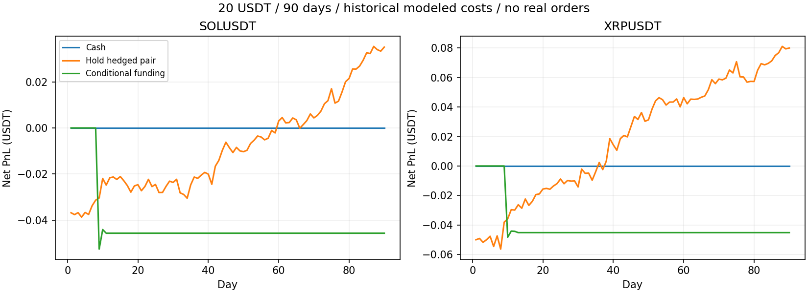

# 20U 小额研究、动态资金费与高杠杆可行性

日期：2026-11-15，香港时间。本轮只做独立历史研究、公开行情采集及模拟约束计算，没有部署 QF-S、重启树莓派、读取交易密钥、调整账户杠杆或发送交易指令。

**判断：以用户约 20 USDT 的预算，优先选择 XRP 作为小额方向策略的后续研究对象，依据是执行门槛；目前没有通过验证的方向盈利信号。新增“动态资金费”方案没有改善收益，不采用它作为赚钱方案。**

用户允许测试 100×、200×。本轮已把这些倍数纳入合约支持范围、成本及逐仓保证金缓冲筛查；没有把它们冒充已经完成的高杠杆历史成交回测。20U 暂按整个独立试验资金理解，不当成单笔必须花完的保证金。单笔模拟损失基准 0.2U 是本轮研究选择，并非用户指定或收益最优参数。

## 这轮实际完成了什么

1. 实现有条件进场、资金费反转退出、对冲亏损退出、保证金缓冲退出、总回撤停止和冷却期。
2. 完成 BTC 两年、三档本金、两档成本、三个政策，共 36 组补充回放。
3. 完成 SOL、XRP 各 90 天、20U、两档成本、三个政策，共 12 组独立回放。
4. 核对四种合约的最小数量、数量步长、当前最高杠杆、维护保证金档位；完成 32 行杠杆可行性筛查。
5. 保留 16 个 BTC/ETH 到期期货当前价差筛查结果。
6. 全部 48 组完成独立资金费和现金账本核对，离线复跑结果相同；tools/tests 共 72 个测试通过。

**原先计划的 BTC/ETH 两年 48 组实验并未完整完成。** ETH 的一个历史分页连续两次读取超时后按预算停止，没有继续反复尝试。完整 BTC 子集通过缓存离线整理，另行登记 20U 用户预算补充，未按盈利结果排除 ETH。原协议、44 次请求记录、4 次失败和错误日志保留。新的 SOL/XRP 小额实验另行登记，48 次公开请求含 3 次失败，均在单请求最多两次、总预算 96 次内完成。两个数据采集任务共 92 次公开行情尝试。

## 新想法怎样响应中途变化

这是待证伪的假说：持续为正的资金费，可能提供足以覆盖交易成本的收入；近期资金费能够延续多久并不知道。

政策在运行前冻结，未看结果后调参数：

- 过去 21 次已发布的结算费率中，至少 17 次为正。
- 预测值取过去 21 次均值与最近 3 次均值的较低值，乘未来 90 次结算，作为假设的 30 天资金费收入。
- 只有预测收入达到四腿估计手续费及滑点的 1.5 倍，才计划进场。预测不是承诺，不能把未来真实结算率提前用于入场。
- 历史费率在结算后一小时才可用于判断；决定后再等待一小时，于下一小时开盘价加不利滑点模拟成交。
- 每小时复核：最近 3 次已发布资金费合计不大于零，或短仓现金权益/标记名义金额低于 25%，或对冲净值亏损达到入场资本 2%，计划退出。
- 账户从峰值回撤达到 3%，停止新增风险并安排退出；退出后冷却 7 天。
- 现货与永续匹配相同币数，用全部资本同时覆盖现货购入、约一份短仓初始名义金额的现金预留及开仓费用；无自动借贷、现金转入或现货抵押折扣假设。
- 发生跳空或小时内保证金耗尽时，标记失败，可执行收益为空；不编造及时止损成交。

现金、开始时入场并持有对冲到期，是同时保留的两组基线。基础成本为现货单边 0.10%、永续单边 0.055%、每腿不利滑点 0.05%。双倍成本场景同时提高入场判断使用的成本和模拟成交成本，因此可能从入场变为全程持有现金，并非对同一成交清单简单改价。

费率是研究假设，参照查阅时的 [Bybit 公开费表](https://www.bybit.com/en/help-center/article/Trading-Fee-Structure)，不是用户实际账户费率。资金费使用实际历史结算率乘结算小时标记开盘价格，依据[官方计算机制](https://www.bybit.com/en/help-center/article/Funding-fee-calculation)。

## 动态想法的结果：没有通过收益检验

BTC 使用与上一轮完全相同的 UTC 年度：2024-11-14 至 2025-11-14，及 2025-11-14 至 2026-11-14。样本已经看过，属于探索研究；没有重新命名成未知测试集。

| BTC 本金 / 政策 | 第一年净收益 | 第二年净收益 |
| --- | --- | --- |
| 20U / 持有对冲 | 0，未满足最小数量 | 0，未满足最小数量 |
| 20U / 动态资金费 | 0，未成交 | 0，未成交 |
| 200U / 持有对冲 | +3.4003% | +0.8912% |
| 200U / 动态资金费 | +0.1943%，进场 3 次 | 0，未进场 |
| 2000U / 持有对冲 | +3.7403% | +0.8912% |
| 2000U / 动态资金费 | +0.3872%，进场 5 次 | 0，未进场 |

本金差异影响数量取整和入场可行性，并不是加大本金会带来预测优势。200U 动态版本第一年手续费约 0.8965U，持有版本约 0.2946U；2000U 动态版本手续费约 14.3756U，持有版本约 3.2404U。按本轮定义的中途变化判断，收益受到进出成本和判断延迟影响，没有优于简单持有。

BTC 基础成本的 200U 持有对冲收益，与上一轮独立日线引擎逐值一致。回撤改用小时收盘采样，第一年约 0.2562%、第二年约 0.2626%；不能与旧日线采样回撤混为同一指标，更不能当成真正盘中最大回撤。

## 20U 真正可执行的小额对照

预先固定 SOL、XRP，UTC 2026-08-16 至 2026-11-14，各 90 天。每币取得现货小时线 2160 根、永续小时线 2160 根、标记小时线 2160 根、资金费 270 次；小时覆盖完整，资金费符合模型支持的固定 8 小时间隔。SOL/XRP 不是在结果出来后按收益排名挑选的赢家。

以下为 20U 初始资本，历史模型的净利润，单位 USDT；不是账户实际赚取的收入。

| 品种 | 持有对冲，基础成本 | 持有对冲，双倍成本 | 动态资金费，基础成本 | 动态资金费，双倍成本 |
| --- | --- | --- | --- | --- |
| SOL | +0.03508 | -0.00406 | -0.04567 | 0，未进场 |
| XRP | +0.08001 | +0.02920 | -0.04523 | 0，未进场 |



基础成本的 SOL 持有版本收到净资金费约 0.07322U，价格损益含滑点约 -0.01435U，手续费约 0.02379U。XRP 对应约 +0.13281U、-0.02191U、-0.03089U，最终约 +0.08001U。

动态版本两币都只完成一轮持仓，分别持有 48、80 小时后按资金费反转规则退出。收取的资金费不足以覆盖进出成本。这解释了失败的具体过程；没有通过调低门槛、延长持有、去掉退出或筛除交易来改善本轮数字。

现金对照始终为零。90 天两个相关币种、各一轮主要持仓，不足以证明未来正期望。XRP 对冲可以作为小额收益机制的研究基线，但这点模型利润远不足以构成收入方案，也没有计税务、转账、机会成本或服务器成本。

## 100×、200×与20U的关系

公开快照的交易所时间为 UTC 2026-11-14 16:23:39，即香港时间 **2026-11-15 00:23:39**。不同接口采集并不同步，以下不是此后持续有效的即时下单报价。

| 合约 | 按快照与规则计算的最小合约名义金额 | 采样时最高杠杆 |
| --- | --- | --- |
| BTCUSDT | 约 65.41U | 150× |
| ETHUSDT | 约 18.28U | 150× |
| SOLUSDT | 约 7.28U | 100× |
| XRPUSDT | 约 5.09U，受最低金额与数量取整共同约束 | 100× |

数据取自[合约信息](https://bybit-exchange.github.io/docs/v5/market/instrument)及[风险限额](https://bybit-exchange.github.io/docs/v5/market/risk-limit)公开接口。用户允许 200× 不代表上述合约实际支持 200×。

作为示例，把 20U 全部视作保证金，100×对应约 2000U 名义仓位，双边 0.055% 手续费约 2.2U；200×对应约 4000U，双边手续费约 4.4U。实际账户还必须预留开平费用、滑点和维护保证金，因此这些是成本算术压力示例，不是可直接提交的仓位。

本轮另按每笔模拟损失上限 0.2U，取“最近 14 根完整小时真波幅均值的两倍，最低价格距离 0.3%”作为止损距离示例，按止损损失加开平手续费和滑点反推数量。该距离只用于可执行性研究，没有构成完整的入场盈利策略。

在这张快照中，BTC、ETH、SOL 的最小合约风险均超过这个基准；XRP 可得到约 7.2015U 名义仓位，模型止损含成本损失约 0.1980U。显示杠杆从 2×改成 100×，这个风险约束下的仓位数量不会增加，盈利也不会因此增加。

XRP 的对应保证金约为：2× 3.6008U、10× 0.7202U、20× 0.3601U、100× 0.0720U。逐仓近似筛查中，100×的初始保证金扣除维护保证金及平仓费后，价格缓冲约 0.445%，小于示例止损距离约 2.54%；它未通过本轮缓冲要求。200×另超出支持上限。

**这项近似只用于逐仓、未追加保证金的筛查。** 全仓、统一账户抵押、自动追加及其它持仓会改变清算条件，实际清算还需完整公式与账户参数。通过筛查不代表精确清算价格已认证，也不代表止损一定成交。报告没有把 100×逐仓的判断外推成所有保证金模式都不可用。

## 到期期货价差：存在候选，当前20U不优先

保留了 16 个 BTC/ETH USDT 到期期货报价，使用现货卖方价买入、期货买方价卖出作筛查。较远期部分价差为正，但存在现金占用、短仓保证金、双腿成交及交割价格偏差问题。

官方[合约介绍](https://www.bybit.com/en/help-center/article/Introduction-to-USDT-Perpetual-Expiry-Contract)说明到期结算采用到期前 30 分钟平均指数价格，因此不能默认卖出现货时恰好成交在同一价格。筛查另列 30 个基点结算错配、未来平仓费用所依赖价格翻倍的压力值；这是情景假设，不是历史观测分布。

官方[专项费用页](https://www.bybit.com/en/help-center/article/Futures-Contracts-Fees-Explained)对 USDT 交割写无结算费，[FAQ](https://www.bybit.com/en/help-center/article/FAQ-USDT-Perpetual-and-Expiry-Contracts)则列 0.05%，存在公开说明差异。行情返回的 deliveryFeeRate 一并保留，计算统一至少预留 0.05%，没有为了产生正收益选择较低费用。

BTC 等币数现货采购就超过 20U。ETH 最小币数现货约 18U，按本轮现金预留及缓冲要求也不适配 20U。用更高杠杆压缩短仓保证金后，需要另证实保证金管理及结算过程；本轮不将其当成已可执行的20U套利。

## 对QF-S下一步的具体判断

- 将 20U 作为后续小额试验资金，独立记账，不把现有模拟账户的大额余额视作可随意调用的后备金。
- XRP 适合作为当前小额方向策略的研究对象；选择依据为最小数量与成本，尚无方向预测优势证明。
- 保留简单资金费对冲作基线，淘汰本轮动态资金费方案作为主动盈利候选；不调参追回它的亏损。
- 高杠杆保留为候选配置和压力场景。先确定可亏损金额、合理价格距离和名义仓位，再选择保证金占用；不默认用满20U保证金。
- 尚未完成方向入场信号研究、真实双腿成交验证、完整清算模型或持续前瞻观测。当前工具没有自动在后台交易，也没有运行账户级20U试验。

高杠杆可以放大一次方向正确时的收益，也会放大错误和成本。本轮没有发现能用来支持高杠杆开仓的稳定信号；这项缺口由后续研究补齐，不能用用户允许承担风险代替盈利证据。

## 可运行成果与复现

代码：[conditional_carry.py](../../tools/conditional_carry.py)、[research_conditional_carry.py](../../tools/research_conditional_carry.py)、[finalize_conditional_subset.py](../../tools/finalize_conditional_subset.py)、[micro_budget_research.py](../../tools/micro_budget_research.py)、[replay_micro_budget.py](../../tools/replay_micro_budget.py)。本轮只增加独立研究模块，没有改旧研究源码或运行策略。

- [BTC全部36组](btc-subset/comparison.csv)，完整小时数据和结果在同目录 gzip 包。
- [20U全部12组](micro-budget/comparison.csv)、[32行杠杆筛查](micro-budget/leverage_feasibility.csv)、[16行期货筛查](micro-budget/expiry_screen.csv)，完整公共数据和结果在同目录 gzip 包。
- 原始失败协议与请求日志、完整后续请求日志均保留在本报告目录。所有费用为模型值，未产生真实交易费用。
- [72个测试结果](python-tests-final.txt)，包括未来数据隔离、时间延迟、反转退出、跳空早于计划退出、缺失数据、最小合约、四腿成本、入场结算边界和杠杆约束。
- 测试先后证据：[feature-before.txt](feature-before.txt)、[reversal-before.txt](reversal-before.txt)、[gap-before.txt](gap-before.txt)、[data-before.txt](data-before.txt)。跳空测试曾暴露新回放器提前假设退出成功的问题，已在登记与历史回放前修复；这不是对生产QF-S已发生故障的归因。
- 48组均完成独立账本复算和离线再运行，[复现证明](replication-check.json)。这个48是BTC补充36加小额12，不是原BTC/ETH计划48。

在仓库根目录执行，无需凭证、网络或第三方Python包；输出目录必须尚不存在：

```powershell
python -m unittest discover -s tools/tests -v
python tools/replay_micro_budget.py --output .audit-private/micro-budget-replay-new
```

回放假定两腿同步按指定价格加滑点成交，未复现部分成交、手续费从收到的现货币扣除、撮合排队或API故障后的补单。结算边界存在官方说明的数秒不确定性，工具固定为边界入场不收当次资金费、边界退出先结算再退出；这仍是模型约定。资金费和保证金入账延迟也未被真实交易所成交证据认证。因此这些结果是可重复的历史研究，不能提升为Demo或实盘业绩。
