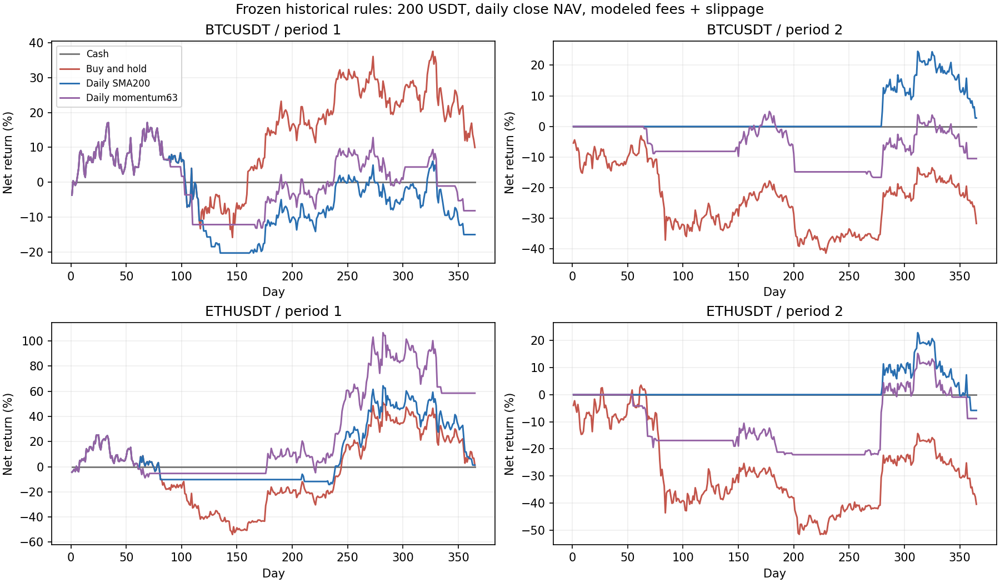
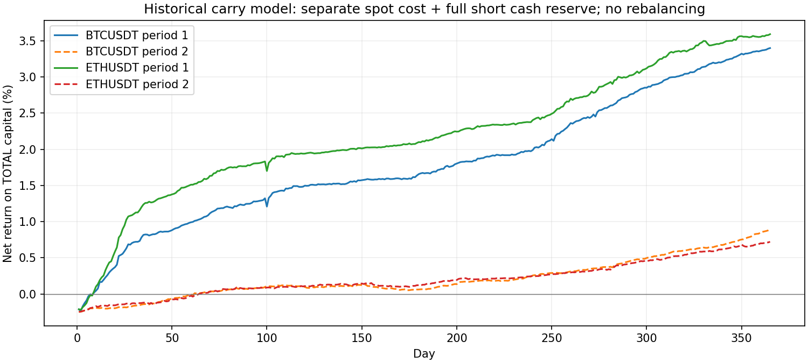

# 虚拟币收益来源实证研究：第一轮

日期：2026-11-14。对象为 QF-S 的后续研究方向。本次新增独立离线研究工具，没有修改运行中的策略、部署树莓派、调用账户接口或发单。

**结论：本轮尚未找到足以认定“能稳定赚钱”的方向策略。资金费对冲值得继续做执行验证，但观察到的收益很低，不能把它包装成小本金赚钱方案。**

本次完成公共历史数据采集、预先登记的 40 组回放、双倍成本压力测试、40 组独立账本复算及完整离线复现。数据、全部失败结果和规则均保留。这里的收益、手续费和滑点是历史模型结果，不是模拟账户实际发生的支出或实盘业绩。

## 先回答“正经量化是一个策略用几年吗”

策略可以长期使用，也可以因优势消失而退役。规则的寿命、仓位的变化和研究更新的频率是三件事。

本次 SMA200 规则每天读取已收盘日线，趋势成立时持有，条件不成立时持有现金。BTC 第一年度持仓 316 天、进场 9 次，第二年度持仓 85 天、进场 1 次。固定规则并不等于一直持仓。它第一年仍亏损，说明能够随行情变化不等于具有预测优势。

同样，“定期换策略”也不是优势来源。需要先定义切换依据和失效条件，用当时能够获得的数据作决定，把切换成本、识别延迟和错误切换一起回放。事后把上涨阶段归给趋势、震荡阶段归给均值回归，会制造不存在的收益。

这轮固定规则，是检验基线跨市场阶段是否可靠。没有测试自动选择策略、状态分类器或动态策略组合，因此不对这些方法作成功或失败的判断。两个年度均为回顾性历史研究；没有拟合参数，也不能称为尚未看过的真正前瞻样本。

## 研究什么钱从哪里来

| 路线 | 收益的经济来源 | 本轮证据与处理 |
| --- | --- | --- |
| 方向与趋势 | 承担价格风险，并尝试利用价格走势的延续 | 测试日线 SMA200、63 日动量，加入持币和现金对照；表现不稳定 |
| 现货加永续空单 | 承接永续市场的多头资金需求，收取正资金费，同时承担基差、保证金及交易所风险 | 用真实历史结算资金费和标记价格回放，结果为正但收益较低 |
| 到期期货基差 | 买入现货、卖出到期期货，持有至结算或提前平仓 | 未取得并核验连续合约链及交割成本，本轮不报收益；永续资金费不能冒充锁定的到期收益 |
| 做市与跨市场套利 | 提供流动性或消除市场之间的价差 | 仅作当前点差成本筛查；缺少历史盘口、排队位置、双腿成交和资金转移证据，不伪造回测 |

[Liu 与 Tsyvinski 的原始研究](https://www.nber.org/papers/w24877)发现过加密资产的时间序列动量现象。这提供了待检验假说，不能证明本轮具体规则现在有效。[BIS 的 Crypto carry 研究](https://www.bis.org/publications/working-paper-1087-crypto-carry)讨论现货与期货对冲收益及保证金、清算风险；其中的历史收益不是当前可获得的收益承诺。

[Makarov 与 Schoar 的原始研究](https://dspace.mit.edu/entities/publication/7f91bfb5-ba77-4d0e-9c79-ec75e104e6cc)记录过跨交易所价差，也指出市场分割及资金流动约束。看到两个报价不同，不能据此认定自己能完成两边成交并提款兑现。

## 固定实验

预登记文件为 [protocol.json](protocol.json)，在首次下载数据之前写入；下载后未改策略、参数、币种、起止时间或成本。

- 品种：BTCUSDT、ETHUSDT。这里只研究两个预选的大币，不能外推为全部币种，更不能据此断言小币没有机会。
- 第一年度：UTC 2024-11-14 00:00 至 2025-11-14 00:00，不含结束时点。
- 第二年度：UTC 2025-11-14 00:00 至 2026-11-14 00:00，不含结束时点。
- 每个独立案例初始虚拟资金 200 USDT；各年度重新开始，结果不直接拼成一个连续账户收益。
- 每币种取得现货日线 970 根、永续日线 970 根，其中各有 240 根预热；小时标记价格 17,520 根、结算资金费 2,190 条。检查覆盖、时间对齐、冲突重复及 OHLC 合法性；两个品种的资金费均覆盖当前 8 小时间隔网格。
- 每个币种、年度测试现金、买入持有、SMA200、63 日动量、资金费对冲五条路线，另加双倍手续费及滑点：共 40 组，全部保留。
- SMA200：收盘价高于截至当日的 200 日均价时计划持有；63 日动量：收盘价高于 63 日前时计划持有。信号在下一日开盘执行。期末平仓时点事前固定。
- 现货最多用可用现金买入，无借币或方向杠杆。每日收盘用预计平仓后净值衡量回撤，没有优化止损，也没有把现金天数剔除。
- 基础成本：现货单边 0.10%、永续单边 0.055%、每一腿逆向滑点 0.05%。费率依据查阅时的 [Bybit 公开普通等级费表](https://www.bybit.com/en/help-center/article/Trading-Fee-Structure)，不是对用户实际账户费率的认证。压力案例把手续费和滑点同时加倍。
- 使用采集时的最小数量、数量步长、最低名义金额约束。它们不是过去每一天交易规则的逐日档案；未建模历史规则变化。

共完成 68 个公共 GET，另一次读取超时；只补齐未成功部分，总计 69 次网络尝试，低于预设 96 次上限。原始响应和失败日志均保留。恢复脚本没有改预登记研究引擎或替换已取得的响应。

## 全部基础成本结果

数值为各 365 天期间净收益率及每日收盘采样最大回撤；手续费、滑点已计入。回撤不是逐笔价格下的真正最大回撤。现金对照为模型中的 USDT 计价余额，不包含币价、脱锚或交易所违约损失。

| 路线 | BTC 第一年 收益 / 回撤 | BTC 第二年 收益 / 回撤 | ETH 第一年 收益 / 回撤 | ETH 第二年 收益 / 回撤 |
| --- | --- | --- | --- | --- |
| 现金 | 0 / 0 | 0 / 0 | 0 / 0 | 0 / 0 |
| 买入持有 | +9.97% / 28.09% | -31.67% / 41.36% | +1.10% / 63.20% | -40.46% / 53.27% |
| 日线 SMA200 | -14.97% / 31.92% | +2.76% / 17.49% | +1.28% / 38.38% | -5.83% / 23.35% |
| 63 日动量 | -8.13% / 25.83% | -10.49% / 20.51% | +58.50% / 27.23% | -8.82% / 22.27% |
| 现货加永续空单 | +3.40% / 0.24% | +0.89% / 0.25% | +3.59% / 0.22% | +0.72% / 0.25% |



方向交易没有跨年度、跨两币一致的证据。ETH 第一年的动量收益很高，第二年仍亏；据此只选择第一年或只报告 ETH 会误导判断。SMA200 第二年 BTC 相对持币显著减损，也不能抵消它在第一年 BTC 的亏损，或证明它有稳定的正期望。

基础案例订单数：持币每个案例 2 笔；SMA200 分别为 BTC 18/2、ETH 14/2；动量分别为 BTC 22/18、ETH 8/18；对冲每个案例 4 笔。完整手续费、交易事件及曲线见压缩结果，未只保留赢家。

## 资金费对冲究竟赚多少

模型买入现货，并做空等量币数的 USDT 永续。200 USDT 同时覆盖现货购入、开仓手续费及约一份初始永续名义金额的现金保证金，不能在买完现货后凭空获得另一笔保证金。

使用[官方资金费历史接口](https://bybit-exchange.github.io/docs/v5/market/history-fund-rate)的实际结算费率，以及每次结算时对应小时的标记开盘价格。正资金费使空单收款，负资金费使空单付款。开仓、最终平仓恰好位于结算时间的资金费统一排除，明确作为边界假设；没有把当前费率乘全年当成历史收益。

| 币种 / 年度 | 收取净资金费 | 基差损益，成本前 | 四腿手续费 | 四腿滑点损失 | 最终净利润 | 对全部 200 USDT 的收益 |
| --- | --- | --- | --- | --- | --- | --- |
| BTC / 1 | 7.1875 | +0.0977 | 0.2946 | 0.1901 | 6.8006 | 3.4003% |
| BTC / 2 | 2.2334 | -0.0226 | 0.2604 | 0.1680 | 1.7825 | 0.8912% |
| ETH / 1 | 7.5419 | +0.1341 | 0.2985 | 0.1926 | 7.1849 | 3.5925% |
| ETH / 2 | 1.8826 | -0.0447 | 0.2400 | 0.1548 | 1.4431 | 0.7216% |

金额单位均为 USDT，属于模型账本。资金费栏已合并正负结算，但还未减交易费用；最终净利润再扣交易费用和滑点，避免重复扣费。



双倍成本后的年度净收益分别为 BTC 3.1580% / 0.6771%，ETH 3.3469% / 0.5242%。最近一年相较前一年明显下降。方向策略在双倍成本下同样没有形成跨币、跨年度一致的盈利，完整 40 行见 [comparison.csv](comparison.csv)。

模型未计税务、入金出金、换汇、服务器维护或资金机会成本，也未与美元无风险利率等替代用途作同风险比较。账面正收益不足以证明这项交易值得做，表中利润也不是最终可支配收入。

负资金费不是罕见的错误数据：四个年度案例分别有 165、302、201、313 次负结算，最长连续负结算分别为 6、14、7、13 次。第二年 BTC 出现 2 个资金费收入为负的日历月分桶，ETH 出现 1 个；年度边界月份是部分月份，详见 [accounting-analysis.json](accounting-analysis.json)。年末赚钱不等于每个月收钱。

保证金检查使用每小时最高标记价格，并保守地在计入当小时资金费前计算空单压力。四个年度案例均未耗尽预留现金；最低空单权益/标记名义金额约为 0.637、1.000、0.387、0.934。合成的三倍上涨场景会触发现金保证金耗尽，即使现货加空单的理论净损益仍为零；此时工具将可执行收益标为空值，保留明确标注的反事实结果。

这只是现金保证金压力筛查。没有逐档维护保证金、清算手续费、盘中毫秒级波动或实际账户抵押折扣模型；不能把上述低日线回撤作为清算概率或尾部损失估计。Bybit 的[官方套利说明](https://www.bybit.com/en/help-center/article/Arbitrage-Trading)也明确提示清算及双腿执行风险。统一账户的真实抵押机制可能不同，需要另外验证。

还缺双腿部分成交、断线补单、手续费币种及费后实际币数、资金费入账延迟、自动借贷设置、标记价与可成交价差异等证据。模型以报价币支付手续费并保持等币数对冲；真实现货手续费若从收到的币扣除，需要按实际成交回报重新配平。

## 做市为什么本轮不优先

采集时的单次永续最优买卖价差：BTC 约 0.0149 个基点，ETH 约 0.0524 个基点。普通等级假设的双边 maker 手续费合计为 4 个基点，明显高于这个报价差。

这个快照只支持“直接吃到所显示的微小价差还不足以覆盖该费率”的成本筛查，不能证明所有做市方式都不赚钱。更宽报价、优惠费率或返佣需要对应成交概率、排队、库存和逆向选择证据。当前没有这些证据，不给 QF-S 编造做市盈利曲线。

## 如何继续，以及什么时候更新策略

本轮不把方向策略接入交易，也不选出 ETH 第一年收益最高的规则作为赢家。对 QF-S 的研究优先级是：

1. **先做资金费双腿的独立 PAPER 验证。** 固定 BTC、ETH，记录可成交双边报价、实际费率假设、两腿币数、资金预留和逐笔资金费。没有验证双腿失败恢复及对账前，不把这一模型接入账户下单。
2. **方向策略保留为研究假说。** 若测试市场状态识别或动态分配，事先冻结状态输入、判定时点、切换条件、交易成本、预算及评估日期。整个“选策略的策略”必须从头到尾回放；所有历史已看样本均标为研究样本，随后需要新的前瞻数据。
3. **分开处理工程停机与策略退役。** 重复订单、数据过期、账目差额或保护失效触发禁止新增风险并继续管理旧仓；收益不好则按预登记评估周期检验优势是否消失，不临时改参数追回亏损。
4. **同时报告现金和持币基准。** 策略赚了钱，还要说明承担多少价格风险、在场多久、回撤多大、手续费多少、是否仅靠一个年度，以及收益是否足以覆盖维护成本。

下一阶段尚未启动持续观测服务，也未完成自动择时、动态配资或真实双腿成交验证。当前结论的可信度是：实验可重复、模型账本正确；未来盈利和可成交性尚未证实。两币两年且行情相关，不能据此估计稳定盈利概率，更不能把日线平滑的对冲曲线视为无风险。

对于 200 USDT 的示例本金，最新一年对冲模型利润不足 2 USDT，即使可以复制也不会成为有意义的收入来源。增大资金或杠杆并不会补上尚未验证的执行能力或策略优势。本轮最有价值的结果，是排除了几个看起来合理却缺乏稳定证据的赚钱说法，并找到了一个可以继续验证、收益预期也能算清的研究方向。

## 代码、数据与复现

- 引擎：[tools/crypto_edge_research.py](../../tools/crypto_edge_research.py)。预登记后源代码哈希未变；全部研究接口为公开行情 GET，未读取凭证。
- 单次有界恢复：[tools/resume_crypto_capture.py](../../tools/resume_crypto_capture.py)，保存原始失败和请求恢复记录。
- 独立四腿现金流、资金费及现货账本复算：[tools/analyze_crypto_edges.py](../../tools/analyze_crypto_edges.py)。40 组均通过。
- 离线复现：[tools/replay_crypto_research.py](../../tools/replay_crypto_research.py)。无需联网或第三方 Python 包。
- [dataset.json.gz](dataset.json.gz) 为本轮完整公共历史数据；[results.json.gz](results.json.gz) 为全部曲线、事件和结果；[artifact-hashes.json](artifact-hashes.json) 保留输入包哈希。原始公共接口响应保存在本地 `.audit-private/crypto-research-20261114`。
- [python-tests.txt](python-tests.txt)：本轮 tools/tests 全部 **61 个测试通过**，其中新增 6 个覆盖时序、对冲、负资金费、四腿成本、保证金耗尽及缺失结算标记价格。初始缺少引擎时的失败记录保留于 [feature-before.txt](feature-before.txt)。
- 独立新目录离线复跑 **40 组结果逐字节一致**，证明见 [replication-check.json](replication-check.json)。这是复现性证据，不是盈利有效性证据。

在仓库根目录执行，输出目录必须尚不存在，避免覆盖历史结果：

```powershell
python -m unittest discover -s tools/tests -v
python tools/replay_crypto_research.py --output .audit-private/crypto-research-replay-new
```

新的市场研究需另建目录和预登记；不要覆盖本轮数据，也不要修改本轮源码后声称复现成功。历史回测、未来 PAPER、交易所 Demo 与实盘必须分别记录。
